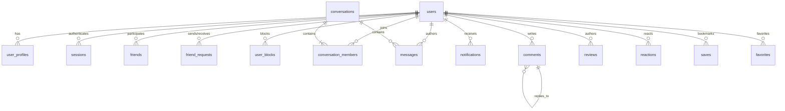

# NostalgicVerse — Phase 11 Data Model & Migrations

## Overview
Phase 11 guarantees that SQLite (`data/nostalgicverse.db`) is the authoritative source of truth for all social interactions. Migration `009_phase11_social_community.sql` hardened table schemas, established partial unique indexes for idempotency, created the `saves` table, and added cascading constraints.

---

## Entity Relationship Diagram



---

## Migration 009 Breakdown

### 1. Message Idempotency Index
```sql
ALTER TABLE messages ADD COLUMN client_message_id TEXT;
CREATE UNIQUE INDEX IF NOT EXISTS idx_messages_client_id 
ON messages(client_message_id) 
WHERE client_message_id IS NOT NULL;
```
Enforces that a replayed `client_message_id` can never produce a duplicate message row in SQLite.

### 2. Universal Saves (Bookmarks) Table
```sql
CREATE TABLE IF NOT EXISTS saves (
    id TEXT PRIMARY KEY,
    user_id TEXT NOT NULL REFERENCES users(id) ON DELETE CASCADE,
    target_type TEXT NOT NULL,
    target_id TEXT NOT NULL,
    created_at DATETIME DEFAULT CURRENT_TIMESTAMP,
    UNIQUE(user_id, target_type, target_id)
);
CREATE INDEX IF NOT EXISTS idx_saves_user ON saves(user_id);
CREATE INDEX IF NOT EXISTS idx_saves_target ON saves(target_type, target_id);
```

### 3. Comment Soft Deletes
```sql
ALTER TABLE comments ADD COLUMN deleted_at DATETIME;
```

### 4. High-Performance Query Indexes
```sql
CREATE INDEX IF NOT EXISTS idx_messages_conv_created ON messages(conversation_id, created_at);
CREATE INDEX IF NOT EXISTS idx_comments_target_created ON comments(target_type, target_id, created_at);
CREATE INDEX IF NOT EXISTS idx_comments_parent ON comments(parent_id);
CREATE INDEX IF NOT EXISTS idx_reviews_target ON reviews(target_type, target_id);
CREATE INDEX IF NOT EXISTS idx_reactions_target ON reactions(target_type, target_id);
CREATE INDEX IF NOT EXISTS idx_notifications_user_unread ON notifications(user_id, is_read, created_at);
CREATE INDEX IF NOT EXISTS idx_friends_user ON friends(user_id);
CREATE INDEX IF NOT EXISTS idx_friend_requests_users ON friend_requests(sender_id, receiver_id);
```

---

## SQLite Database Configuration

In `server/db/connection.cjs`, the connection runs in production-grade reliability mode:
- **Foreign Keys**: `PRAGMA foreign_keys = ON;` (Guarantees referential integrity; rejects orphaned records).
- **WAL Journal Mode**: `PRAGMA journal_mode = WAL;` (Enables concurrent readers while writes execute).
- **Synchronous**: `PRAGMA synchronous = NORMAL;` (Optimal balance of durability and disk write performance).
- **Busy Timeout**: `PRAGMA busy_timeout = 5000;` (Waits up to 5 seconds during lock contention rather than throwing SQLITE_BUSY).

