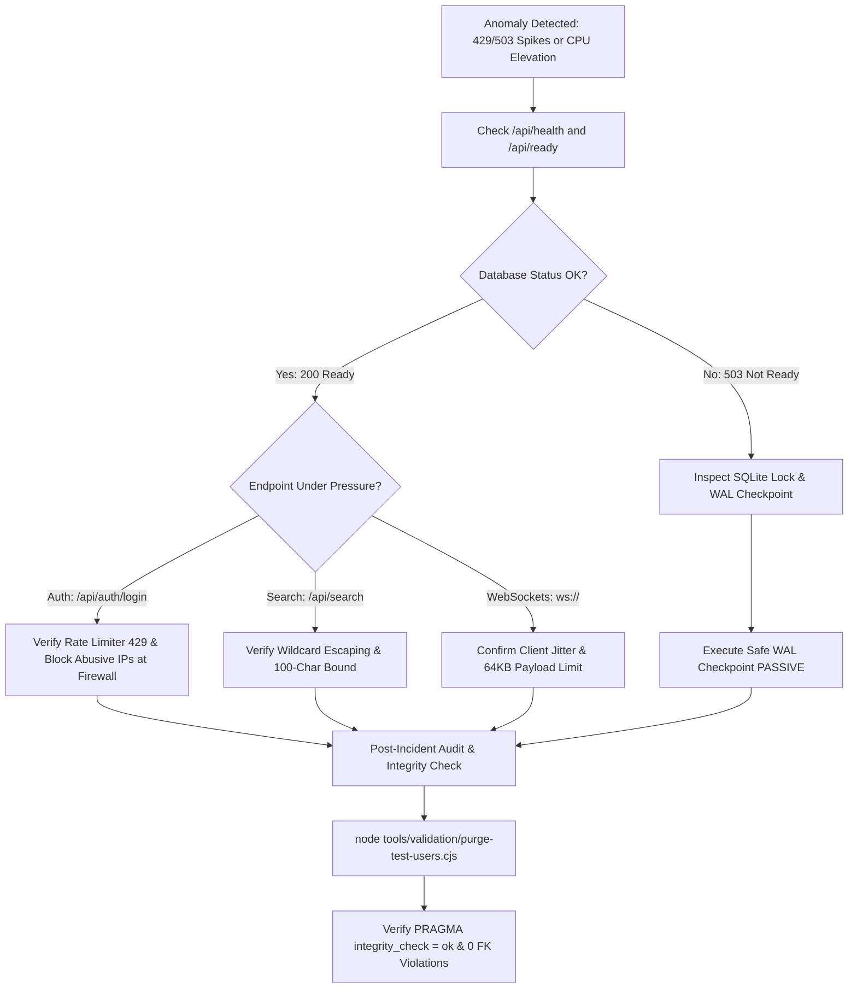

# Phase 13 — Security Incident Response & Threat Runbook

## 1. Overview & Operational Scope

This runbook establishes standard operating procedures (SOP) for detecting, containing, mitigating, and reviewing security and traffic anomalies on NostalgicVerse.

---

## 2. Threat Classification & Playbooks

### 2.1 Threat Scenario 1: Credential Stuffing & Auth Brute-Force Floods
- **Symptoms**:
  - High volume of `POST /api/auth/login` requests within seconds.
  - Spikes in HTTP 401 (Unauthorized) and HTTP 429 (Too Many Requests).
  - CPU elevation due to PBKDF2 hashing attempts.
- **Automated Defenses in Place**:
  - `authLoginLimiter` strictly throttles each IP to 10 attempts per minute.
  - Excess requests are dropped with `429 Too Many Requests` in $<1\text{ms}$ before reaching PBKDF2 libuv worker threads.
- **Operator Runbook**:
  1. Inspect incoming logs for source IPs:
     ```powershell
     Get-Content server.log -Tail 100 | Select-String "429"
     ```
  2. If traffic originates from a distributed botnet, apply edge firewall block via Cloudflare or Nginx:
     ```nginx
     deny <abusive-subnet>/24;
     ```
  3. Verify system health at `/api/ready` to ensure event loop and database remain responsive.

---

### 2.2 Threat Scenario 2: Search Engine DDoS & Wildcard Floods
- **Symptoms**:
  - High frequency of `/api/search?q=...` queries with excessive wildcards (`%%%%%`, `_____`) or lengthy random strings.
- **Automated Defenses in Place**:
  - Input length bounded to 100 characters max (`q.slice(0, 100)`).
  - Wildcard escaping: `%` and `_` characters are escaped to prevent unbounded full-table scans.
  - Subqueries enforce explicit `LIMIT 15` directly in SQL.
  - `searchLimiter` restricts each IP to 60 queries per minute.
- **Operator Runbook**:
  1. Verify search query latency remains bounded:
     ```powershell
     node tools/load-tests/search-storm.cjs
     ```
  2. If an abusive actor is bypassing limits via rotating proxies, lower `searchLimiter` threshold in `server/middleware/rateLimitMiddleware.cjs` temporarily.

---

### 2.3 Threat Scenario 3: WebSocket Reconnect Stampedes (Thundering Herd)
- **Symptoms**:
  - Immediately following a server restart or network glitch, thousands of WebSocket clients simultaneously attempt to handshake.
- **Automated Defenses in Place**:
  - Frontend client `assets/js/realtime-client.js` implements **Full Randomized Jitter** ($75\% \text{ to } 125\%$ of exponential backoff), breaking synchronization locks.
  - Page visibility hook: Inactive browser tabs suspend reconnection loops until the tab is focused by the user.
  - Server bounds incoming payloads to 64KB (`maxPayload: 65536`).
- **Operator Runbook**:
  1. Check connected socket count:
     ```powershell
     Invoke-RestMethod http://localhost:3000/api/health
     ```
  2. Verify ping/pong roundtrip latency remains under 5ms:
     ```powershell
     node tools/load-tests/websocket-storm.cjs
     ```

---

### 2.4 Threat Scenario 4: Database Lock Contention Spikes
- **Symptoms**:
  - Multiple concurrent community write actions (comments, reactions, reviews) trigger `SQLITE_BUSY`.
- **Automated Defenses in Place**:
  - `PRAGMA busy_timeout = 5000` allows SQLite to wait for write locks up to 5 seconds.
  - `executeWithRetry` performs exponential backoff with random jitter across 3 retries.
  - Explicit multi-statement transactions are serialized via `dbAsync.transaction` promise mutex queue, eliminating `cannot start a transaction within a transaction` collisions.
- **Operator Runbook**:
  1. Check WAL checkpoint status:
     ```powershell
     node -e "const { dbAsync } = require('./server/db/connection.cjs'); dbAsync.get('PRAGMA wal_checkpoint(PASSIVE)').then(console.log);"
     ```
  2. Run the database write contention diagnostic:
     ```powershell
     node tools/load-tests/db-contention.cjs
     ```

---

## 3. Incident Escalation & Response Flowchart



---

## 4. Post-Incident Forensic Verification Checklist

1. **Verify Database Integrity**:
   ```powershell
   node -e "const { dbAsync } = require('./server/db/connection.cjs'); dbAsync.get('PRAGMA integrity_check').then(console.log);"
   ```
2. **Verify Relational Consistency**:
   ```powershell
   node -e "const { dbAsync } = require('./server/db/connection.cjs'); dbAsync.all('PRAGMA foreign_key_check').then(console.log);"
   ```
3. **Verify User Account Authorization**:
   Confirm that only authoritative accounts exist: `owner` (OWNER), `sufiyan0207` (USER), `keep-me-up` (USER).
   ```powershell
   node tools/validation/purge-test-users.cjs
   ```
4. **Create Immediate Verified Snapshot**:
   ```powershell
   node tools/maintenance/disaster-recovery.cjs snapshot
   ```

