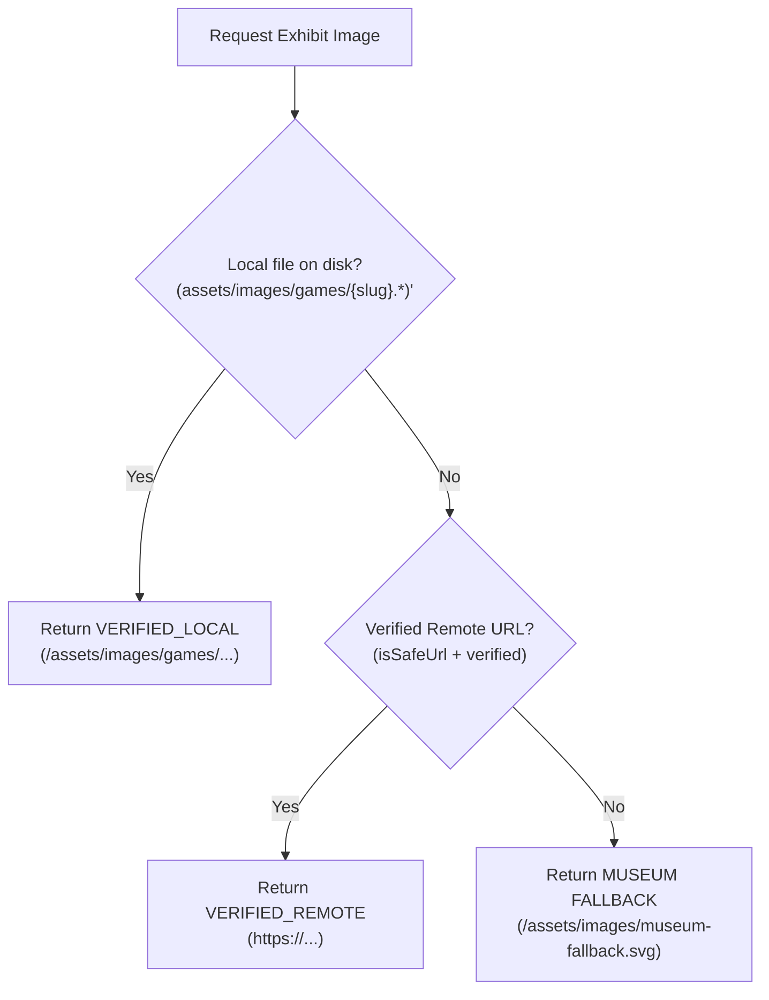

# NOSTALGICVERSE — PHASE 15 MEDIA ARCHITECTURE

**System:** Core Media Intelligence Engine & Asset Resolution Pipeline  
**Version:** 2026.1.0  
**Authority:** NostalgicVerse Curatorial & Digital Preservation Engineering  

---

## 1. Architectural Philosophy

NostalgicVerse operates under a strict curatorial and fault-tolerant media principle:
```
DATABASE CANONICAL RECORDS (`game_images`, `media_metadata`)
        ↓
CORE MEDIA SERVICE (`server/services/mediaService.cjs`)
        ↓
DERIVED CANONICAL REGISTRY (`data/media/game-images.json`)
        ↓
UNIFIED MEDIA RESOLVER (`resolveGameImage`)
        ↓
PUBLIC PRESENTATION SURFACES (Homepage, Archive, Exhibits, Search, Favorites)
```

No remote network failure, rate limiting (HTTP 429), access restriction (HTTP 403), or broken URL (HTTP 404) is ever allowed to bring down the user interface or create broken image indicator boxes (`broken image icon`) or flash-to-blank states.

---

## 2. Media Resolution Hierarchy

When any component renders game artwork, it invokes `resolveGameImage(game)`:



1. **Tier 1 — Local Verified Asset:**
   - Physical presence in `assets/images/games/{slug}.webp` (or `.jpg`, `.png`).
   - Magic bytes and header validated on disk.
   - Zero external network dependencies.
2. **Tier 2 — Remote Verified Source:**
   - URL verified via SSRF guards and HTTP HEAD/GET range inspection.
   - Magic bytes confirmed (`image/jpeg`, `image/png`, `image/webp`).
   - Content-Type header confirmed.
   - Hosted on allowed, non-private public domains.
3. **Tier 3 — Museum Accession Fallback Plate:**
   - Vector SVG plate at `/assets/images/museum-fallback.svg` and `/assets/images/games/fallback.webp`.
   - Scalable, crisp retro-inspired CRT/cartridge archival insignia.
   - Preserves card structure, aspect ratio, and typography with zero layout shifts (CLS = 0).

---

## 3. Remote Fetch Security & SSRF Protection

All server-side remote fetches pass through `isSafeUrl(urlString)` in `server/services/mediaService.cjs`:
- **Protocol Whitelist:** Strictly `http:` and `https:`. All other schemes (`file:`, `javascript:`, `data:`, `ftp:`, `gopher:`) are blocked.
- **Private IP Blocking:**
  - `127.0.0.0/8` (Loopback subnet)
  - `::1` (IPv6 loopback)
  - `10.0.0.0/8` (Private Class A)
  - `172.16.0.0/12` (Private Class B)
  - `192.168.0.0/16` (Private Class C)
  - `169.254.0.0/16` (Link-local & Cloud Metadata endpoint `169.254.169.254`)
  - Cloud internal hostnames (`metadata.google.internal`, `instance-data`)
- **Port Safeguards:** Rejection of non-standard internal database/administration ports (22, 3306, 5432, 6379, 27017).

---

## 4. Binary Inspection & HTML Error 200 Trap Defense

Many retro gaming hosts and CDN servers return HTTP status 200 with an HTML error page body (e.g., Cloudflare challenge, Hotlink Forbidden HTML, 404 landing page). Blindly checking `res.statusCode === 200` causes corrupted image displays.

NostalgicVerse inspects the first 32KB of data:
- Rejects bodies starting with `<!DOCTYPE html`, `<html`, `<?xml`, `<head>`, or `<body>`.
- Matches binary signatures:
  - **PNG:** `0x89, 0x50, 0x4E, 0x47, 0x0D, 0x0A, 0x1A, 0x0A`
  - **JPEG:** `0xFF, 0xD8, 0xFF`
  - **WebP:** `RIFF` ... `WEBP`
  - **GIF:** `GIF87a` / `GIF89a`

---

## 5. Header Dimension Extraction & Aspect Ratio Governance

Zero-dependency binary parser extracts width and height directly from stream bytes:
- Calculates proportional aspect ratio: `1:1`, `4:5`, `3:4`, `2:3`, `3:2`, `4:3`, `16:9`, `9:16`, `20:9`.
- Public card layouts reserve explicit container space using CSS `aspect-ratio` and `object-fit: contain` to prevent Cumulative Layout Shift (CLS).

---

## 6. Rate Limiting & 429 Backoff Engine

When remote image verification encounters HTTP 429 (Too Many Requests):
- Applies exponential backoff per domain (`5s * 2^(consecutive429 - 1)`, capped at 60s).
- Defers further requests to the affected domain until `cooldownUntil` expires.
- Never crashes the server process or stalls the verification worker.

